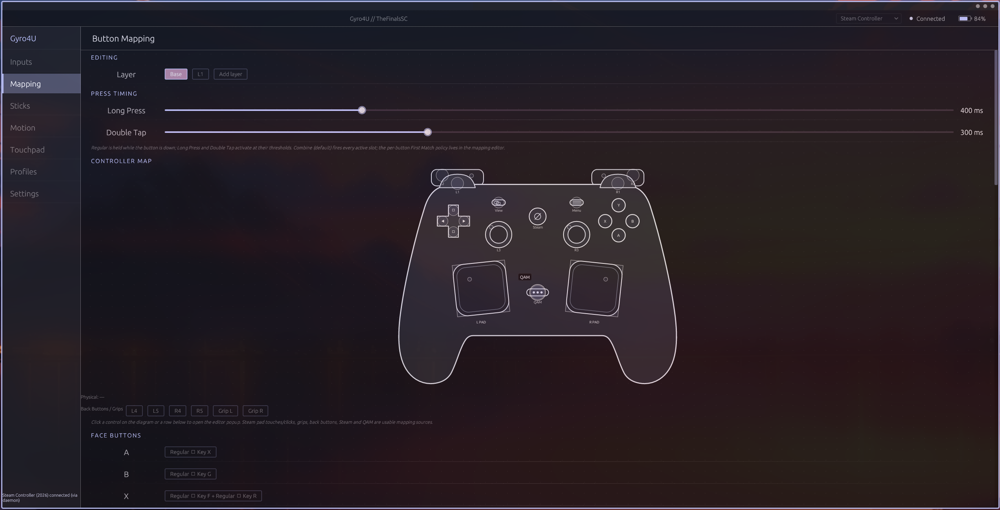

[](https://stand-with-ukraine.pp.ua)

[](https://standforukraine.com/)

---

[](https://github.com/theblack-don/gyro4u)

# Gyro4U

Native Linux GUI tool for configuring DualSense controllers.

> [!note]
> **DualSense Edge** is supported and tested, including the Edge paddles and Fn buttons.

Gyro4U is based on [DS4U](https://git.yokai.digital/deadYokai/ds4u) by deadYokai
([GitHub mirror](https://github.com/deadYokai/ds4u)).



## Features

### Controller & inputs
- Live input visualization (buttons, D-pad, sticks, triggers, touchpad)
- Battery level and charging status
- USB and Bluetooth connection, with automatic hotplug detection
- DualSense Edge paddles and Fn buttons

### Remapping
- Remap buttons to gamepad buttons, keyboard keys, mouse buttons, or scroll wheel directions
- Layers: hold an activator button to swap in a second set of bindings
- Press types per binding: `Regular`, `Long Press`, `Double Tap`
- Profile targets: bind a button to cycle or switch profiles
- Digital stick directions (including WASD-style key output)
- Right-stick mouse

### Analog sticks
- Per-stick sensitivity curves
- Inner and outer deadzones per stick
- Invert X / Y per stick
- Swap left/right sticks
- Digital stick output with configurable deadzones

### Gyroscope
- Gyro-to-mouse output with activation modes (always, hold, toggle, touchpad)
- Dots-per-360 calibration, sensitivity, acceleration, smoothing, and axis inversion

### Adaptive triggers
- Independent left/right configuration
- Effect modes: `Off`, `Feedback`, `Weapon`, `Bow`, `Galloping`, `Vibration`, `Machine`
- Adjustable start/end position, strength and frequency
- Per-trigger deadband (release point and full-stroke point)

### Haptics & vibration
- Haptic patterns: `Constant`, `Pulse`, `Ramp`, `Wave` (with strength and speed)
- Raw PCM haptic streaming to the voice-coil actuators (USB, and Bluetooth via the daemon)

### Lightbar & LEDs
- RGB lightbar color, brightness and on/off
- Animated lightbar effects (via the daemon):
    - **Breath**
    - **Rainbow**
    - **Strobe**
- Player-number indicator LEDs
- Microphone mute LED: `Off`, `On`, `Pulse`

### Audio
- Output routing: internal speaker, headphone, or both
- Microphone on/off toggle

### Profiles
- Save, load, switch and delete profiles (see [Profiles](#profiles))
- A profile captures everything: lightbar/LEDs, sticks, triggers, haptics, gyro,
  touchpad, mic, plus button remaps and disabled buttons
- Switch/list/reload profiles from the [command line](#command-line-usage)

### Firmware
- Read the controller's current firmware version and build info
- Check the latest firmware version
- Download and flash official firmware for DualSense / DualSense Edge

### Themes
- Built-in themes:
    - Default
    - Author theme (my custom theme)
    - Deep Dark
    - Tokyo Night
    - Noctalia (follows the current Noctalia / KineticWE color scheme)
- The Noctalia theme reads the colors Noctalia generates for GTK/KDE and refreshes automatically when the palette changes.
- Custom theme support (see [Custom Themes](#custom-themes))

### Daemon
- Background service that keeps the controller connection alive and runs live effects and input processing (see [Daemon](#daemon))
- Start/stop directly from the GUI, run via the CLI, or install as a systemd user service

## Installation

### Nix (flakes)

From the repository:

```sh
nix profile install .#gyro4u
```

Or directly from GitHub:

```sh
nix profile install github:theblack-don/gyro4u
```

The package installs the `Gyro4U` desktop entry and hicolor icon. See the
[NixOS](#nixos) notes for `uinput` and udev setup.

### Fedora / COPR

A spec file is provided at `packaging/fedora/gyro4u.spec`. Create a COPR project
from the GitHub repository and point it at that spec; once the project has built:

```sh
sudo dnf install gyro4u
```

The source tag `v0.2.0` must exist for the RPM `Source0` URL. COPR builds may
need vendored crates or network access for Cargo; configure the project
accordingly.

## Building

### Requirements
- Rust
- libraries: `libudev`, `alsa-lib`, `openssl`, `libxkbcommon`

### Build
```sh
git clone https://github.com/theblack-don/gyro4u.git
cd gyro4u
cargo build --release
```

### Run
```sh
./target/release/gyro4u
```

### Nix

```sh
nix build .#
./result/bin/gyro4u
```

Or run it directly:

```sh
nix run .#
```

### Device permissions

To talk to the controller without running as root, install a `udev` rule that
grants your user access to the DualSense `hidraw` device and to `uinput`.
The RPM package installs these files for you; when building from source or
using Nix, install them manually (on NixOS use the configuration below).

`/etc/udev/rules.d/70-gyro4u.rules`:

```
SUBSYSTEM=="hidraw", ATTRS{idVendor}=="054c", ATTRS{idProduct}=="0ce6", MODE="0664", GROUP="input", TAG+="uaccess"
SUBSYSTEM=="hidraw", ATTRS{idVendor}=="054c", ATTRS{idProduct}=="0df2", MODE="0664", GROUP="input", TAG+="uaccess"
KERNEL=="uinput", SUBSYSTEM=="misc", MODE="0660", GROUP="input", TAG+="uaccess", OPTIONS+="static_node=uinput"
```

`/etc/modules-load.d/gyro4u.conf`:

```
uinput
```

Then load the module and reload the rules, and reconnect the controller:

```sh
sudo modprobe uinput
sudo udevadm control --reload-rules && sudo udevadm trigger
```

## Command-line usage

Running `gyro4u` with no arguments launches the GUI.
The following flags talk to a running daemon over its Unix socket:


| Command | Description |
|---------|-------------|
| `gyro4u` | Launch the GUI |
| `gyro4u --daemon` | Run as the background daemon |
| `gyro4u --status` | Show the connected controller (serial, product id, USB/BT) and battery |
| `gyro4u --list-profiles` | List saved profile names |
| `gyro4u --switch-profile <name>` | Switch the active profile |
| `gyro4u --reload-profile` | Reload the current profile from disk |


The profile commands require the daemon to be running.

## Daemon

The daemon is a background process that owns the controller connection and runs
the *continuous* work the GUI cannot do on its own.  
While it runs it:
- maintains the connection to the controller and watches for hotplug events,
- applies the active profile, and
- runs the live loops for **animated lightbar effects**, **haptic-pattern playback**, **gyro processing**, and **input transforms** (stick curves, deadzones, invert/swap, button remap, touchpad behavior).

One-shot hardware settings (lightbar color, brightness, player LEDs, mic, mic LED) work whether or not the daemon is running;  
the live/animated features above need it.

### Starting daemon

From the GUI (Settings), via the CLI, or as a service.

```sh
gyro4u --daemon
```

Or run as a systemd user service (`gyro4u-daemon.service`):

```ini
[Unit]
Description=Gyro4U daemon
After=graphical-session.target

[Service]
ExecStart=/usr/bin/gyro4u --daemon
Restart=on-failure
RestartSec=3

[Install]
WantedBy=default.target
```

### NixOS

Enable `uinput` and add the udev rules:

```nix
hardware.uinput.enable = true;

services.udev.extraRules = ''
  SUBSYSTEM=="hidraw", ATTRS{idVendor}=="054c", ATTRS{idProduct}=="0ce6", MODE="0664", GROUP="input", TAG+="uaccess"
  SUBSYSTEM=="hidraw", ATTRS{idVendor}=="054c", ATTRS{idProduct}=="0df2", MODE="0664", GROUP="input", TAG+="uaccess"
  KERNEL=="uinput", SUBSYSTEM=="misc", MODE="0660", GROUP="input", TAG+="uaccess", OPTIONS+="static_node=uinput"
'';
```

When running the daemon as a systemd user unit from a Nix profile, point it at
the profile binary:

```ini
[Service]
ExecStart=%h/.nix-profile/bin/gyro4u --daemon
```

## Profiles

Profiles are stored as JSON in `~/.config/gyro4u/profiles/<name>.json`, and the
filename is derived from the profile name.
The active profile name is recorded in `settings.json`. A `Default` profile is created automatically if none exists.

Manage profiles from the GUI (the **Profiles** section) or from the [command line](#command-line-usage).

## Custom Themes

Filename must match `id` field inside JSON.

### Theme file format
```json
{
  "id": "tokyo_night",
  "name": "Tokyo Night",
  "dark_mode": true,
  "colors": {
    "window_bg":       [26,  27,  38],
    "panel_bg":        [22,  22,  30],
    "extreme_bg":      [16,  16,  24],
    "accent":          [122, 162, 247],
    "widget_hovered":  [41,  46,  66],
    "widget_inactive": [32,  36,  54],
    "text":            [192, 202, 245],
    "text_dim":        [86,  95,  137],
    "success":         [158, 206, 106],
    "error":           [247, 118, 142],
    "warning":         [224, 175, 104]
  }
}
```

All color values are `[R, G, B]` in the 0–255 range.

### Color roles

| Key              | Description                                      |
|------------------|--------------------------------------------------|
| `window_bg`      | Main application background                      |
| `panel_bg`       | Sidebar and panel backgrounds                    |
| `extreme_bg`     | Deepest background (headers, separators)         |
| `accent`         | Highlights, active indicators, selected items    |
| `widget_hovered` | Widget background on hover                       |
| `widget_inactive`| Widget background at rest                        |
| `text`           | Primary text                                     |
| `text_dim`       | Secondary / hint text                            |
| `success`        | Success indicators (e.g. connected, applied)     |
| `error`          | Error indicators                                 |
| `warning`        | Warning indicators                               |

## Config & Data Paths

| Path | Contents |
|------|----------|
| `~/.config/gyro4u/settings.json` | Active theme ID and active profile name |
| `~/.config/gyro4u/profiles/` | Saved profiles (`<name>.json`) |
| `~/.config/gyro4u/themes/` | Custom theme files (`<id>.json`) |
| `$XDG_RUNTIME_DIR/gyro4u.socket` | Daemon Unix socket |

On first run, an existing `~/.config/ds4u` directory is copied to
`~/.config/gyro4u`; the old directory is left untouched.

## Contributing

See [CONTRIBUTING.md](CONTRIBUTING.md).

## References:
- https://github.com/nowrep/dualsensectl
- https://github.com/hurryman2212/vds

## Todo
- [ ] other possible issues
- [x] DualSense Edge support

## Support:
Support the original DS4U author:
[](https://yokai.digital)
[](https://www.paypal.com/donate/?hosted_button_id=RLGYGXH4LZ8PC)
[](https://send.monobank.ua/jar/9oVcUiHxPd)
[](https://liberapay.com/deadYokai/donate)
